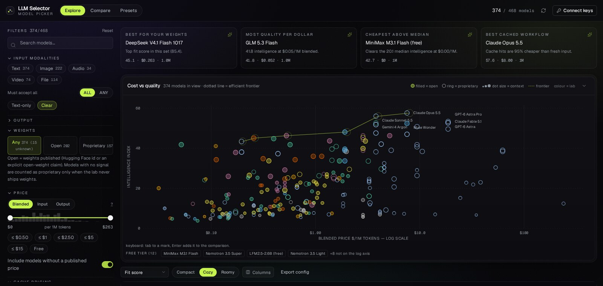

# LLM Selector

**Find the model that fits your constraints, not the one on the leaderboard.**

LLM Selector is a local-first model picker for the OpenRouter catalogue. Filter 460+ chat models by
modality (text / image / audio / video / file), open vs proprietary weights, blended price, cache
pricing, context window and benchmark floors — then compare what survives on a log-scale cost/quality
scatter, a benchmark profile and a leaderboard. Save filter sets as presets, and move your whole setup
in and out as JSON.

> **Naming:** *SOM* is the system family — a system that orchestrates models (`jev`, `leya`); inside an LLM system you find the individual models (`gpt`, `opus`, …). This project is the **LLM Selector**: the thing that picks the model.
>
> Code: MIT. Data: see [Data sources & attribution](#data-sources--attribution). This is an
> independent project — not affiliated with, endorsed by, or sponsored by OpenRouter or Artificial
> Analysis.



---

## Why another model picker

Every "best LLM" list answers a question you did not ask. The useful question is *"of the models I can
actually call, which ones accept my input, cost what I can spend, and clear the quality bar I need?"*

LLM Selector treats that as a filter problem plus a scoring problem:

- **Hard constraints** narrow the catalogue using only published facts.
- **fit score** ranks what remains with weights *you* set. It is computed **inside the current result
  set**, so it answers "which of these" rather than "which in absolute terms".
- **Provenance is always visible.** A missing benchmark renders as `—`, never as `0`. Benchmarks
  matched onto a model by heuristic carry a confidence label.

## Quickstart

```bash
git clone https://github.com/frederico-kluser/llm-selector.git
cd llm-selector
pnpm install
pnpm dev            # API on :8899, web on :5173
```

Open <http://localhost:5173>. The catalogue loads without any key. Click **Connect keys** to add:

| Key | What it unlocks | Required? |
| --- | --- | --- |
| OpenRouter (`sk-or-v1-…`) | Your account credits, live provider stats per model | No — the catalogue is public |
| Artificial Analysis (`aa_…`) | Intelligence / coding / agentic + domain indices, cache pricing, throughput | No — but benchmarks need it |

Keys stay in the browser and are forwarded to your own SOM API process; nothing is sent anywhere else.

### Without a server

`pnpm build` produces a static site plus a catalogue snapshot fetched at build time. Everything except
live benchmark data works from static hosting. Artificial Analysis does not send CORS headers, so
benchmarks need the local API (or your own proxy) — that is the only reason the server exists.

```bash
pnpm build && pnpm start   # one process serving the built app and the API
```

## Features

**Filtering** — 20+ facets, each with facet counts computed against all *other* active filters:

- input modality with `all` / `any` semantics (`text` + `image` + `audio` + `video` + `file`)
- output modality (text, image, audio, embeddings)
- open vs proprietary vs unknown weights (tri-state, never folded together)
- blended / input / output price with a log-mapped dual-thumb slider
- cache-read price ceiling and minimum cache discount
- context window floor, capabilities (tools, structured output, reasoning, web search, prompt cache)
- benchmark floors for every axis your key exposes
- provider, release recency, and variant switching (free / batch / alias)

**Comparison** — cost-vs-quality scatter with an efficient-frontier overlay, radar profile for up to
four models, ranking bars, and a side-by-side metric table. Free models are listed in their own strip
because $0 cannot sit on a log axis.

**Presets** — save the current filter + sort + score weights under a name, load curated starters, and
export/import the entire configuration as JSON. Imports merge with a diff (new / updated / unchanged)
and default to *keep both* on a name collision, so an import can never silently destroy your presets.

**URL state** — the address bar is a readable serialisation of your view, so a filtered comparison is
a link.

## How the data is assembled

```
OpenRouter /api/v1/models ──► normalise ──┐
                                          ├─► join ──► /api/catalog ──► React app
Artificial Analysis /api/v2 ──► normalise ┘
```

- **Universe** = every model OpenRouter will actually route to (free and paid variants included).
- **Join** walks a ladder and records which rung matched: exact slug + index confirmation → slug →
  similarity with a version-token guard → reject. Image/audio generators are never matched onto text
  benchmark rows.
- **Prices** are converted from per-token strings to USD per 1M tokens; `null` means "not published",
  and the engine never treats it as `$0`.
- **Benchmark units** are normalised to 0–100 whether the source publishes a 0–1 fraction or an index.

## Data sources & attribution

| Source | Used for | Terms |
| --- | --- | --- |
| [OpenRouter](https://openrouter.ai) | Model catalogue, pricing, modalities, capabilities | Public API, called at runtime; no snapshot is committed to this repository |
| [Artificial Analysis](https://artificialanalysis.ai) | Benchmark indices, cache pricing, throughput | Fetched with **your** key, held in a short-lived in-memory cache, never committed or redistributed |

Required attribution as displayed in the app footer:

> Models & pricing: OpenRouter · Benchmarks: **Source: Artificial Analysis (artificialanalysis.ai)**
> · Not endorsed by or affiliated with Artificial Analysis or OpenRouter.

**Before you host SOM publicly**, read [NOTICE.md](NOTICE.md). Artificial Analysis's terms restrict
redistributing its data and building comparison products on it without written consent; the Free key
is for internal use. Running SOM locally with your own key is the intended, documented path.

## Privacy & your API key

- Keys live in `sessionStorage` by default. **Remember this device** opts into `localStorage`.
- Keys are never written to the repository, never included in JSON exports, never placed in the URL,
  and never logged server-side (the API logs status codes, not headers).
- Because the browser must read the key to build an `Authorization` header, no client-side storage can
  protect it from XSS. Keep the app on a trusted origin, and prefer a limited-scope key. See
  [SECURITY.md](SECURITY.md).

## Architecture

```
src/
  lib/         filter engine, SOM scoring, presets/JSON schema, URL codec, API client
  components/  charts (SVG, no chart dependency), filter rail, virtualised table, panels
  store/       zustand store with persistence of the view (never the keys)
shared/        pure ESM used by BOTH the server and the tests — normalisation, AA adapters, join
server/        ~250 line Express app: catalogue cache, AA proxy, provider proxy, account
scripts/       build-catalog.mjs → generated snapshot (git-ignored, fetched at build time)
tests/         vitest: filter semantics, scoring, joining, AA shape adapters, config round-trip
```

Charts are hand-built SVG: a log-scale scatter with collision-avoided labels, a radar with per-axis
normalisation, and baseline-anchored bars. No charting library, no runtime config fetch, no telemetry.

## Scripts

| Command | What it does |
| --- | --- |
| `pnpm dev` | API + Vite dev server together |
| `pnpm build` | Generate the catalogue snapshot, typecheck, build |
| `pnpm start` | Serve the built app + API |
| `pnpm test` | Unit tests (33 specs) |
| `pnpm typecheck` | `tsc --noEmit` |
| `pnpm catalog` | Refresh only the snapshot |

## Status

Early (`0.x`). The JSON config format is versioned (`version: 1`) and validated with zod on import, but
may gain keys in a minor release; unknown keys are ignored rather than rejected.

## Roadmap

- [ ] Per-provider price/throughput spread inside the model drawer (API exists)
- [ ] Benchmark confidence intervals and "tied" rendering
- [ ] Additional benchmark sources (Epoch AI, LMArena) behind the same join
- [ ] Deploy recipe: one-command Docker image
- [ ] Localisation (pt-BR, es)

## Contributing

PRs are welcome — see [CONTRIBUTING.md](CONTRIBUTING.md) and the
[Code of Conduct](CODE_OF_CONDUCT.md). New filters need a unit test; new data sources need a
documented licence note.

## License

Code: [MIT](LICENSE). The names "SOM" / "LLM Selector" and the logo are not covered by the MIT grant
(see [NOTICE.md](NOTICE.md#trademarks)).

Benchmark and catalogue data remain the property of their providers, under their own terms.
